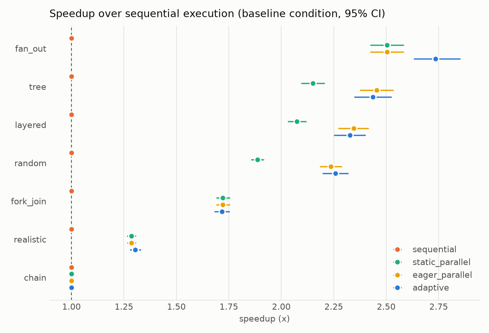
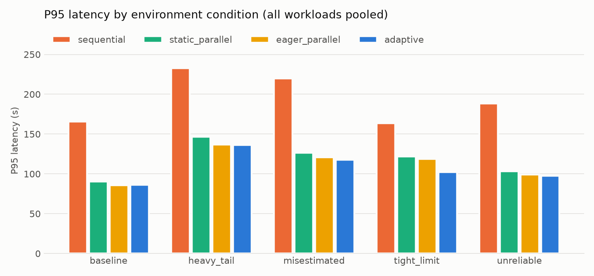

# Adaptive Parallelism and Task Scheduling for LangGraph Agents

[](https://github.com/Thrya29/Adaptive-Parallelism-and-Task-Scheduling-for-LangGraph-Agents/actions/workflows/ci.yml)


> **Research question.** Can an algorithm predict which tasks of an LLM agent workflow should run
> in parallel and which sequentially — choosing the execution architecture that minimizes latency
> and cost without reducing task success?

**Full research report: [docs/REPORT.md](docs/REPORT.md).**

This project builds a LangGraph workflow that decomposes a request into tasks, represents their
dependencies as a **DAG**, **estimates task costs**, analyses the **critical path**, and uses a
**cost-aware adaptive scheduler** to run independent tasks concurrently only when doing so pays
off. It is evaluated against sequential and static-parallel execution.

## Motivation

Adding more agents is not a free win. A large controlled study of 180 agent configurations found
that centralized multi-agent coordination improved a parallelizable financial-analysis benchmark by
80.9%, yet every multi-agent variant degraded a sequential planning benchmark by 39–70%, and
independent agents amplified errors 17.2× ([Kim et al., 2025][scaling]). LLMCompiler showed that
planning function calls as a DAG and executing them in parallel can cut latency up to 3.7×
([Kim et al., 2024][llmcompiler]) — but it parallelizes eagerly.

This project asks the next question: **when** is parallelism worth it, and **how much**? Instead of
adding agents, it treats agent execution as a classical scheduling problem with LLM-specific costs
(rate limits, duplicated context, merge overhead, per-call latency).

## Status

| Phase | Scope | Status |
|---|---|---|
| 0 | Project scaffold, configuration, CI, design docs | ✅ done |
| 1 | Core algorithms: DAG model, validation, critical path, list scheduler, task fusion | ✅ done |
| 2 | Cost model, mock LLM, simulator, Monte Carlo strategy selector | ✅ done |
| 3 | LangGraph planner / executor / synthesizer, Anthropic backend, reliability | ✅ done |
| 4 | Benchmark suite, experiments, statistics, figures | ✅ done |
| 5 | Real-LLM validation (Claude Haiku 5.5), calibration fix, research report | ✅ done |
| 6 | FastAPI service, observability, Docker, deployment | ✅ done |

## Quickstart

Requires Python 3.11+.

```bash
git clone https://github.com/Thrya29/Adaptive-Parallelism-and-Task-Scheduling-for-LangGraph-Agents.git
cd Adaptive-Parallelism-and-Task-Scheduling-for-LangGraph-Agents
python -m venv .venv
# Windows: .venv\Scripts\activate    macOS/Linux: source .venv/bin/activate
pip install -e ".[dev,anthropic,experiments,api,observability]"
apsched info
```

### With or without an API key — both work

| You have… | What happens |
|---|---|
| **No API key** | Runs on a deterministic **mock LLM** that simulates realistic latency, token usage and failures. Free, offline, reproducible. |
| **An Anthropic API key** | Put it in `.env` (copy from `.env.example`) as `ANTHROPIC_API_KEY=...`; real Claude calls are used automatically. |

Control it explicitly with `APSCHED_LLM_PROVIDER` (`auto` | `mock` | `anthropic`) or per command:

```bash
apsched --provider mock info
```

### Run the agent

```bash
apsched run "Research the EV markets of India, China and Germany, then compare their growth and risks, then write a short investment summary"
apsched run --strategy sequential "..."     # or static_parallel / eager_parallel baselines
apsched run --json "..."                    # full machine-readable result
```

Example output (mock LLM, no key; mock latencies run at 0.1x wall-clock):

```
Plan (7 tasks, attempts=1):
  [retrieval ] s1_1: Research the EV markets of India
  [retrieval ] s1_2: Research the EV markets of China
  [retrieval ] s1_3: Research the EV markets of Germany
  [reasoning ] s2_1 <- s1_1, s1_2, s1_3: compare their growth
  [reasoning ] s2_2 <- s1_1, s1_2, s1_3: compare their risks
  [reasoning ] s3_1 <- s2_1, s2_2: write a short investment summary
  [synthesis ] final <- s3_1: Combine the results into the final answer to the request.

Strategy: adaptive -> adaptive[k=3,fused]
  estimated work W=41.2s, critical path S=25.2s, parallelism W/S=1.63
  candidate                    mean      p95    cost $  calls   succ
  adaptive[k=3]               30.7s    52.4s   0.01689    7.1  1.000
 *adaptive[k=3,fused]         30.7s    53.2s   0.01681    6.2  1.000
  adaptive[k=2]               32.5s    53.8s   0.01689    7.1  1.000
  adaptive[k=1]               41.7s    62.3s   0.01690    7.1  1.000
  ...

Execution timeline:
  s1_1              |#######                                                     |   0.37s completed
  s1_2              |##########                                                  |   0.54s completed
  s1_3              |###############                                             |   0.83s completed
  s2_1              |               ######                                       |   0.34s completed
  s2_2              |               ##############                               |   0.81s completed
  fused:s3_1..final |                             ###############################|   1.77s completed

Metrics: wall-clock 4.42s (plan 0.86s, select 0.13s, execute 3.40s, synthesize 0.00s)
         7 model calls, 4228 in / 3247 out tokens, ~$0.02046, peak concurrency 3, success=yes
```

The selector ran the three lookups concurrently (k = 3, the plan's width) and fused the final
chain `s3_1 → final` into one call, saving a model call at no latency cost.

### Run it as a service

```bash
apsched serve --port 8080                     # or: docker compose up --build  (API + Prometheus)
curl -X POST localhost:8080/v1/runs -H 'content-type: application/json'   -d '{"request": "Compare PostgreSQL, MySQL and SQLite, then recommend one"}'
curl -N -X POST localhost:8080/v1/runs/stream -H 'content-type: application/json'   -d '{"request": "Research A, B and C, then compare them"}'   # live Server-Sent Events
```

JSON and streaming endpoints, health/readiness probes, Prometheus metrics, OpenTelemetry traces
(one span per task: the trace *is* the schedule), structured JSON logs with request ids, API-key
auth, admission control and timeouts. Non-root Docker image, docker-compose, Kubernetes manifest
and Cloud Run instructions: [docs/DEPLOYMENT.md](docs/DEPLOYMENT.md).

### Use it as a library

```python
import asyncio
from adaptive_scheduler.agent import AdaptiveAgent, Strategy
from adaptive_scheduler.config import Settings

agent = AdaptiveAgent.from_settings(Settings())  # mock or Anthropic, per your settings
result = asyncio.run(agent.arun("your request", strategy=Strategy.ADAPTIVE))
print(result.answer, result.metrics, result.decision.config_name)
```

API keys are read only from the environment / `.env` (git-ignored) and are never logged.
Note: API keys come from [console.anthropic.com](https://console.anthropic.com) and are separate
from a Claude.ai subscription.

## Design overview

```
Request → Planner → DAG validator → Cost estimator → Critical-path analyzer
        → Strategy selector (sequential | static-parallel | adaptive, concurrency k, fusion)
        → Priority-queue list scheduler → LangGraph executor → Synthesizer → Response
                     ↑                                              │
                     └──────── observed latency / tokens (learning) ┘
```

| Concern | Technique |
|---|---|
| Dependency model | DAG; Kahn's topological sort, cycle detection, transitive reduction |
| Latency bound | Critical path (longest path DP), work/span, `max(S, W/k)` lower bound |
| Ordering | HEFT-style upward rank in a priority queue (list scheduling, Graham bound) |
| Architecture choice | Monte Carlo prediction of mean / P95 latency and cost per strategy |
| Call reduction | Task fusion by dynamic programming on chains |
| Adaptation | Online cost-model updates; contextual bandit (stretch goal) |

Full details: [docs/ARCHITECTURE.md](docs/ARCHITECTURE.md).

## Results

Two kinds of evidence: a large **simulation study** (136,000 runs) that sweeps regimes a live
API cannot cheaply produce, and a **live validation on real Claude Haiku 5.5 calls** (160
executions, 609 task calls, $0.70) that checks the simulation's model and conclusions.
Full write-up: [docs/REPORT.md](docs/REPORT.md).

### Live validation on Claude Haiku 5.5

Each request is planned once by the real LLM planner and the same plan is executed under every
strategy. Run 1 (3 repetitions) and run 2 (fresh confirmation) give:

| strategy | run 1 mean / P95 | speedup vs sequential [95% CI] | run 2 mean / P95 | speedup [95% CI] |
|---|---|---|---|---|
| sequential | 37.3 s / 74.4 s | 1.00x | 39.3 s / 78.7 s | 1.00x |
| static parallel | 23.5 s / 45.2 s | 1.59x [1.48, 1.71] | 24.2 s / 47.6 s | 1.63x [1.41, 1.86] |
| eager parallel | 23.7 s / 44.9 s | 1.57x [1.45, 1.71] | 26.2 s / 45.7 s | 1.50x [1.25, 1.79] |
| **adaptive** | **22.4 s / 42.9 s** | **1.66x [1.53, 1.80]** | **23.8 s / 38.6 s** | **1.65x [1.37, 1.99]** |

- 100% success, equal cost across strategies; adaptive chose `k = 1` for every single-task plan
  and `k = plan width` otherwise. Real plans were shallow (2-4 branches) and never rate-limited,
  so the parallel strategies tie within their CIs - the regime where simulation also predicts
  ties. The robust effect is parallel vs sequential.
- **Real LLM latency is ~linear in output length** (corr 0.93, ~190 tokens/s, ~0.7-0.85 s fixed
  overhead); concurrent calls slow each other by only 1-3%. Haiku 5.5 (adaptive thinking on by
  default) wrote 4-6x more tokens than the priors assumed, with large per-task variance.
- **The live run exposed a calibration flaw, which was fixed and confirmed on fresh data.** The
  first estimator over-predicted latency by +54% in aggregate: predictions made with the *actual*
  token counts correlate 0.98 with measured makespans, so the structure was right, but output
  lengths were estimated poorly and the shrinkage never released a 2.6x-too-slow prior. The
  revised estimator (shrinkage on total evidence, decayed per-type output-length means and
  spreads, measured residual noise) gives **+1.4% bias in a prequential replay and -2.4% on a
  fresh confirmation run**, with P50 / P95 coverage of 45% / 88% (ideal 50% / 95%).

```bash
apsched live-bench --reps 3 --budget 2 --out docs/results/live    # needs ANTHROPIC_API_KEY; ~$0.5
```

### Simulation study

All numbers below come from `apsched bench --profile full` (full report:
[docs/results/RESULTS.md](docs/results/RESULTS.md); raw data in `docs/results/`).

**Setup.** 34 workloads in 7 families (chains, fan-outs, fork-joins, trees, layered and random
DAGs, and plans derived from 10 natural-language requests) × 5 environment conditions
(`baseline`, `tight_limit` = provider allows 2 concurrent calls, `heavy_tail`, `unreliable` = 4×
failure rate, `misestimated` = the provider is slower than the scheduler believes) × 8 strategies
× 100 paired seeds = **136,000 runs**. The selector predicts on its own seeds; strategies are
scored on shared evaluation seeds; hindsight-optimal configurations are determined on a separate
200-run oracle sample per candidate. Latencies include the selector's own compute time.

#### Pooled results (all workloads)

| condition | sequential | static parallel | eager parallel (LLMCompiler-style) | **adaptive** |
|---|---|---|---|---|
| baseline | 73.6 s | 42.6 s | 40.2 s | **39.9 s** (1.84× [1.81, 1.88]) |
| tight provider limit | 73.4 s | 56.6 s | 55.6 s | **48.0 s** (1.53× [1.51, 1.54]) |
| heavy-tailed latency | 96.2 s | 61.7 s | 57.6 s | **56.9 s** (1.69× [1.66, 1.72]) |
| unreliable provider | 81.4 s | 48.1 s | 45.1 s | **45.0 s** (1.81× [1.78, 1.84]) |
| misestimated cost model | 99.0 s | 60.3 s | 57.0 s | **55.5 s** (1.79× [1.76, 1.81]) |

Mean end-to-end latency; adaptive's speedup over sequential with a paired-bootstrap 95% CI.




#### Findings

1. **H1 - the adaptive scheduler never loses to the right fixed strategy, and the right fixed
   strategy changes.** Across 35 (family × condition) cells, adaptive is within 5% of the best fixed
   strategy in **100%** of cells and better or equal in 66% (median 1.8% better on the
   latency/P95/cost objective; worst cell +3.8%). No fixed strategy has that property: sequential
   is right for chains, eager fan-out for benign wide graphs, bounded concurrency under rate limits.
2. **Blind fan-out is punished by provider limits.** With a 2-call provider limit, eager and
   static fan-out queue on HTTP-429 back-off; adaptive bounds concurrency at the limit and is
   **14% faster in mean and P95** than the LLMCompiler-style eager baseline (48.0 s vs 55.6 s;
   P95 102 s vs 119 s). Level-synchronous execution (what LangGraph supersteps give you) is
   7-18% slower than adaptive in every condition because of barrier stalls.
3. **H2 - dependency-blind multi-agent execution collapses on dependent work.** Running all agents
   at once without their upstream inputs and aggregating with a decision agent looks fastest
   (2.0× over sequential) but succeeds in only **7.5-22%** of runs on chains, trees, fork-joins,
   layered and random DAGs (vs ~100% for DAG execution), and 69-78% even on mostly parallel
   plans - the error-amplification mechanism reported for independent multi-agent systems. The
   per-task quality q = 0.8 is an assumption; the report includes a sensitivity table for
   q in [0.6, 1.0].
4. **H3 - critical-path priority helps, modestly.** Versus FIFO ordering with the same selector:
   -2.4% mean and -1.9% P95 latency (p < 0.001, 17,000 pairs), largest under tight limits.
5. **H4 - task fusion saves calls without hurting success, modestly.** -2.5% model calls and
   -0.8% cost, no change in success rate, latency +0.2%. Fusion only applies to linear chain
   segments, which are a small part of most plans.
6. **The selector is accurate, and robust to a wrong cost model.** It picked the
   hindsight-optimal configuration in **70%** of units and one within 5% of optimal in **91%**
   (mean regret 1.0%). Its latency predictions are within ±1.1% when the cost model is right.
   When the provider is 30% slower than believed, predictions are off by -30% but the *ranking* of
   configurations is preserved, so decisions stay near-optimal (mean regret 1.1%).
7. **Honest negative result.** A simple rule - `k = min(provider limit, plan width)` with
   critical-path priority - matches the adaptive scheduler's latency (within 1%; adaptive is
   0.4 s slower on average, statistically significant but practically negligible). The Monte Carlo
   selector's measurable gains over that rule are fewer calls and lower cost (fusion), and it
   *derives* the rule from the cost model rather than hard-coding it; it does not find extra latency
   beyond it in these conditions. With 3,400-17,000 pairs per test, even tiny differences are
   "significant", so effect sizes, not p-values, should be read.

#### Methodological lessons the experiments surfaced (and fixes)

- **Noise-aware constraints.** The selector originally filtered candidates by *Monte Carlo
  estimated* success rate with a 1% tolerance - below the ~2% sampling error at 64 samples - so
  noise excluded good configurations (10% slower under `unreliable`). Success probability is now
  computed **analytically** (`prod (1 - (1 - p)^(retries+1))`), which is exact in the model.
- **Noisy oracles.** Under heavy-tailed latency a 30-run mean has a ~±30% confidence interval;
  "24% regret" cases turned out to be correct choices once re-scored on 400 runs. Hindsight is now
  scored on a separate 200-run oracle sample, and strategy comparisons use 100 paired seeds.
- **Evaluate distributions, not draws.** Latency is right-skewed, so a correct model shows a
  positive median error per run; forecasts are judged by aggregate bias and quantile coverage.
- **Simulated ground truth must not depend on beliefs.** Feeding the estimator's beliefs into the
  mock's "true" output lengths made estimates random-walk; the mock now has fixed true lengths.

Reproduce everything (about 2-3 minutes on 4 cores, no API key):

```bash
apsched bench --profile full --jobs 4 --out docs/results
apsched bench --profile quick          # seconds; smoke test
```

## Development

```bash
ruff check . && ruff format --check .   # lint / format
mypy                                    # strict type checking
pytest --cov                            # tests (mock LLM; no key needed)
pre-commit install                      # optional git hooks
```

## Repository layout

```
src/adaptive_scheduler/
  graph/        Task / TaskGraph model, Kahn's sort, cycle detection, transitive reduction,
                critical path, upward rank, slack, graph profile and bounds
  scheduling/   ReadyQueue (shared by simulator and executor), list / sequential /
                level-parallel schedulers, schedule validator, chain-fusion DP
  cost/         provider latency & pricing model, per-task token profiles (information
                flows along edges), online estimator (weighted least squares + EWMA)
  simulation/   stochastic discrete-event engine (client slots, provider cap / rate limits,
                contention, heavy tails, retries, failure isolation) and the Monte Carlo
                strategy selector
  llm/          deterministic MockChatModel (LangChain-compatible) and provider factory
  agent/        LangGraph workflow (plan -> repair -> schedule -> execute -> synthesize),
                LLM and heuristic planners, async TaskExecutor, prompts
  bench/        workload families, environment conditions, dependency-blind baseline,
                experiment runner, statistics (bootstrap, Wilcoxon, Holm), report & figures,
                live validation harness, prequential replay
  api/          FastAPI service: JSON + SSE endpoints, auth, admission control, timeouts
  observability/ Prometheus metrics, OpenTelemetry spans, JSON logging (all from run events)
  events.py     typed run events: the single source for streaming, metrics and traces
  report.py     text rendering of a run (plan, candidate table, Gantt timeline, metrics)
  config.py     settings and LLM provider resolution (auto | mock | anthropic)
  cli.py        `apsched` command
tests/
  unit/         hand-checked examples
  property/     Hypothesis invariants over thousands of random DAGs
  integration/  end-to-end agent runs on the mock LLM; live Anthropic test (`pytest -m live`)
docs/           architecture, deployment guide; results/ holds benchmark data and figures
deploy/         Prometheus config, Kubernetes manifest
Dockerfile, docker-compose.yml
```

### What the tests guarantee

Property-based tests (300 random DAGs per property, up to 24 tasks) check that for every graph,
duration vector, worker count `k` and priority policy:

- every schedule is valid: each task runs once, after all of its dependencies, never more than `k`
  at a time (checked by an independent validator);
- `max(S, W/k) <= makespan <= W/k + (1 - 1/k)·S` — the theoretical lower bound and Graham's
  list-scheduling bound;
- with `k >= n` workers the list scheduler achieves the critical path exactly;
- the chain-fusion DP equals brute-force enumeration of all segmentations, and fusion never
  increases total work or the critical path;
- the transitive reduction preserves reachability and is minimal;
- with randomness switched off, the stochastic engine reproduces the deterministic list and
  level-parallel schedulers exactly, and every task is accounted for (completed / failed /
  cancelled) under random failures and rate limits.

## References

- Y. Kim et al. *Towards a Science of Scaling Agent Systems.* arXiv:2512.08296, 2025.
  Blog: [When and why agent systems work][scaling-blog], Google Research, Jan 2026.
- S. Kim et al. *An LLM Compiler for Parallel Function Calling.* ICML 2024. [arXiv:2312.04511][llmcompiler]
- H. Topcuoglu, S. Hariri, M.-Y. Wu. *Performance-Effective and Low-Complexity Task Scheduling for
  Heterogeneous Computing* (HEFT). IEEE TPDS, 2002.
- R. L. Graham. *Bounds on Multiprocessing Timing Anomalies.* SIAM J. Appl. Math., 1969.

## License

[MIT](LICENSE)

[scaling]: https://arxiv.org/abs/2512.08296
[scaling-blog]: https://research.google/blog/towards-a-science-of-scaling-agent-systems-when-and-why-agent-systems-work/
[llmcompiler]: https://arxiv.org/abs/2312.04511
