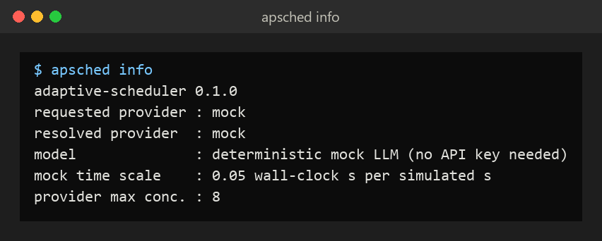
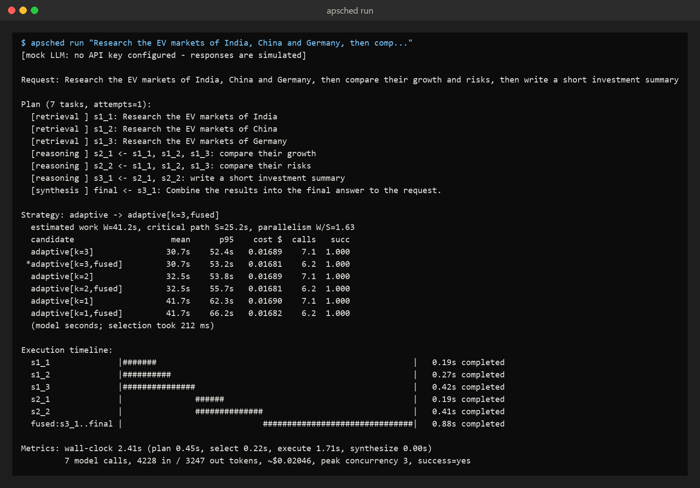
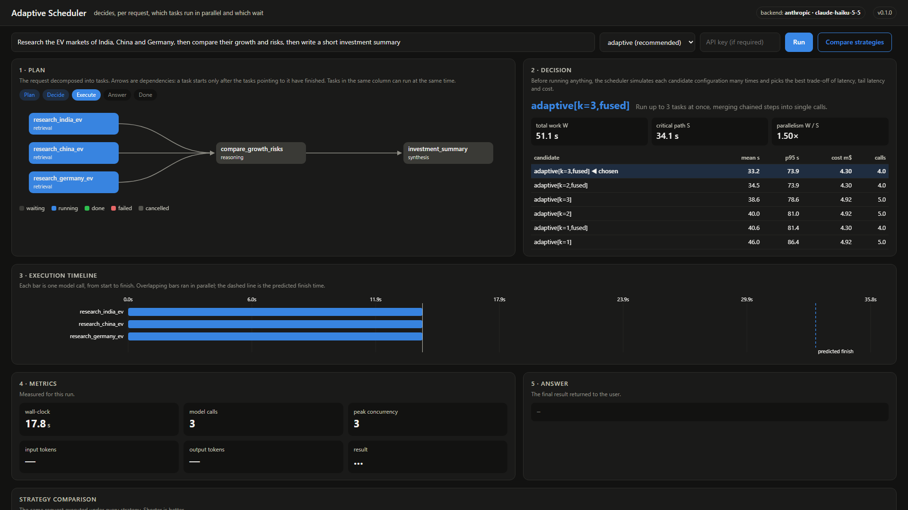
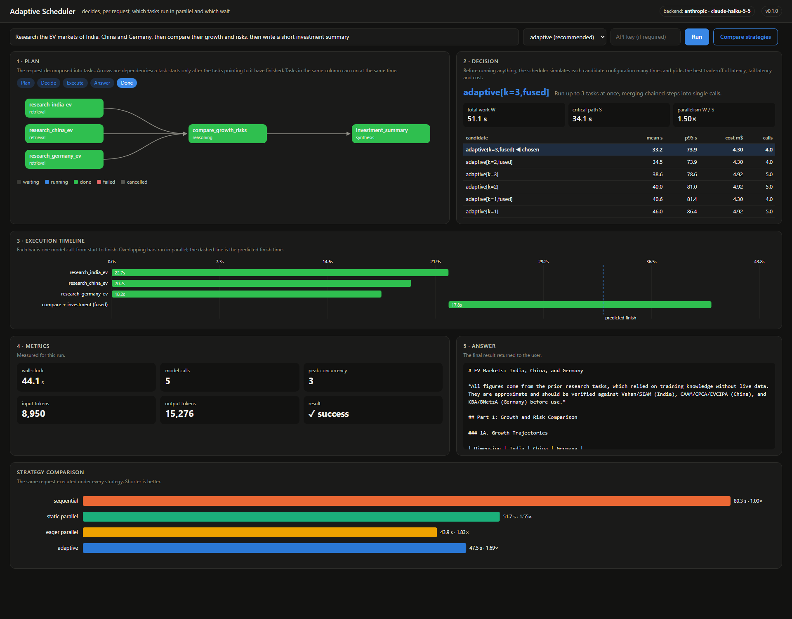
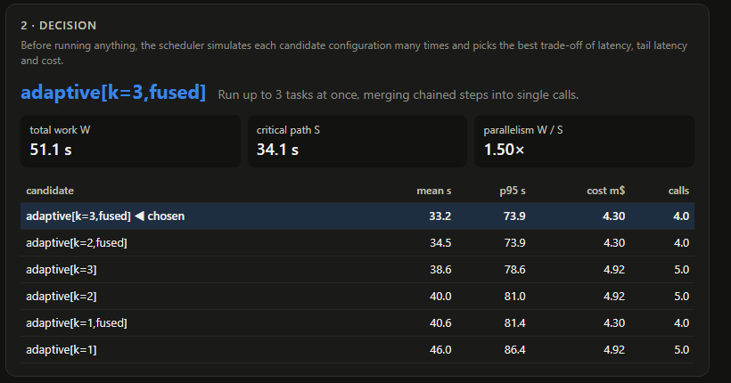
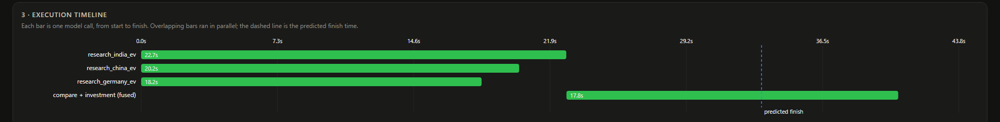
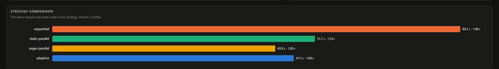
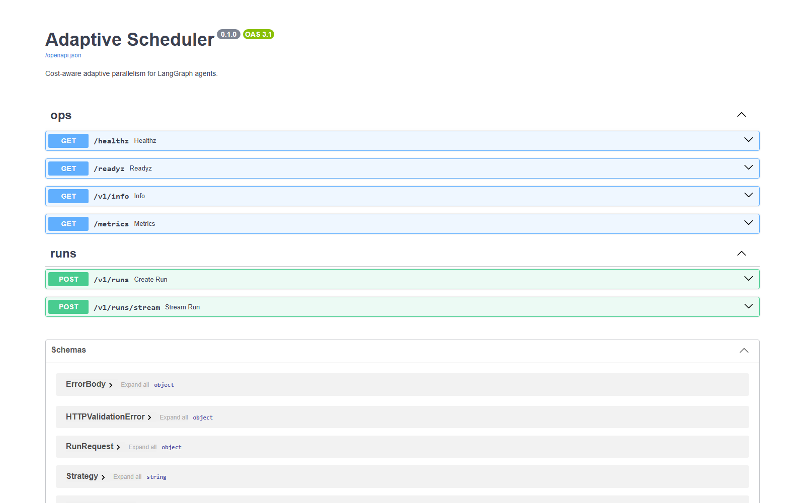
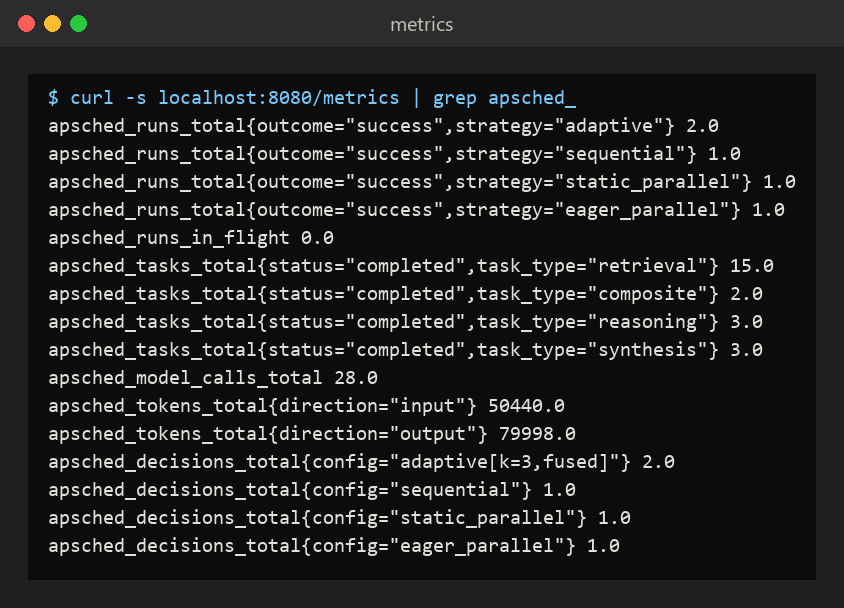

# User manual

This guide takes you from a fresh machine to running the system every day. Every screenshot below
was captured from the real software.

**Contents**
1. [What the system does](#1-what-the-system-does)
2. [Before you start](#2-before-you-start)
3. [First-time setup](#3-first-time-setup)
4. [Your first run (terminal)](#4-your-first-run-terminal)
5. [The dashboard](#5-the-dashboard)
6. [Daily use](#6-daily-use)
7. [Using the API from your own code](#7-using-the-api-from-your-own-code)
8. [Monitoring](#8-monitoring)
9. [Experiments and calibration](#9-experiments-and-calibration)
10. [Configuration](#10-configuration)
11. [Troubleshooting](#11-troubleshooting)
12. [FAQ](#12-faq)

---

## 1. What the system does

You give it a request in plain language, for example *"Research the EV markets of India, China
and Germany, then compare their growth and risks, then write a short investment summary"*. It
handles the request in five steps:

1. **Plans.** A language model breaks the request into tasks and records which tasks need the
   output of which others. The result is a dependency graph.
2. **Decides.** Before running anything, a scheduler simulates several ways of executing that
   graph. It predicts each one's latency, worst-case latency and cost, and picks the best. The
   options include all in sequence, up to *k* tasks at once, and merging chained steps into a
   single call.
3. **Executes.** It runs the tasks with that configuration. Independent tasks run at the same
   time, and a task starts as soon as everything it depends on has finished.
4. **Answers.** It returns the final result, with a full record of what ran, when, and at what
   cost.
5. **Learns.** Every call it observes updates the cost model, so later decisions improve.

You can watch all of this live in a web dashboard, use it from the terminal, or call it as an
HTTP API.

## 2. Before you start

| You need | Why | Check with |
|---|---|---|
| Python 3.11 or newer | runs the system | `python --version` |
| git | downloads the code | `git --version` |
| *(optional)* Docker Desktop | one-command deployment with monitoring | `docker --version` |
| *(optional)* an Anthropic API key | real Claude answers instead of the built-in simulator | see below |

**No API key? No problem.** Without a key, everything runs on a built-in **mock LLM**. It
simulates realistic response times, token counts and occasional failures. It's free, works
offline, and is ideal for learning the system. The answers it returns are placeholder text.

**To get real answers,** create an API key at [console.anthropic.com](https://console.anthropic.com)
→ *API Keys*. API keys are billed separately from a Claude.ai chat subscription. A typical request
costs well under one US cent on Claude Haiku.

## 3. First-time setup

Open a terminal (PowerShell on Windows, Terminal on macOS or Linux) and run:

```bash
git clone https://github.com/Thrya29/Adaptive-Parallelism-and-Task-Scheduling-for-LangGraph-Agents.git
cd Adaptive-Parallelism-and-Task-Scheduling-for-LangGraph-Agents
python -m venv .venv
```

Activate the virtual environment. You need to do this in every new terminal:

```bash
# Windows (PowerShell)
.venv\Scripts\activate
# macOS / Linux
source .venv/bin/activate
```

Install the project with the web service and monitoring components:

```bash
pip install -e ".[api,observability,anthropic]"
```

**Optional: add your API key.** Copy the example settings file and put your key in it:

```bash
# Windows
copy .env.example .env
# macOS / Linux
cp .env.example .env
```

Open `.env` in any editor and fill in the line `ANTHROPIC_API_KEY=sk-ant-...`. Never commit or
share this file; it is already listed in `.gitignore`.

**Check the installation:**

```bash
apsched info
```



`resolved provider` tells you which backend will be used: `mock` (no key) or `anthropic` (key
found). You can force either one per command with `apsched --provider mock ...` or
`apsched --provider anthropic ...`.

## 4. Your first run (terminal)

```bash
apsched run "Research the EV markets of India, China and Germany, then compare their growth and risks, then write a short investment summary"
```



How to read the output, from top to bottom:

* **Plan.** The tasks and their dependencies. `s2_1 <- s1_1, s1_2, s1_3` means *s2_1 needs the
  results of s1_1, s1_2 and s1_3*. The three `s1_*` tasks depend on nothing, so they can run at
  the same time.
* **Strategy.** The scheduler's decision and the evidence behind it:
  * `estimated work W` is the total time if every task ran one after another.
  * `critical path S` is the longest chain of tasks that must run in order. No schedule can
    finish faster than this.
  * `parallelism W/S` is how much faster parallel execution could possibly be. 1.0 means
    *none*: the work is inherently sequential.
  * The **candidate table** lists every configuration it simulated, with predicted mean
    latency, 95th-percentile latency, cost, number of model calls and success rate. The row
    marked `*` was chosen. `k=3` means up to 3 tasks at once; `fused` means chained steps were
    merged into one model call to save overhead.
* **Execution timeline.** One row per model call. `#` marks show when it was running. Rows that
  overlap ran in parallel.
* **Metrics.** Total time split into planning, selection, execution and synthesis, plus model
  calls, tokens, estimated cost and the peak number of simultaneous calls.

Useful options:

```bash
apsched run --strategy sequential "..."   # force a fixed strategy: sequential | static_parallel | eager_parallel
apsched run --json "..."                  # the complete result as JSON (plan, decision, every task, metrics)
```

## 5. The dashboard

Start the service and open the dashboard in your browser:

```bash
apsched serve --port 8080
```

Then go to **http://localhost:8080**, type a request (or keep the example), and press **Run**.

**While a request is running:**



**When it has finished:**



The panels follow the life of a request:

| Panel | What it shows | How to read it |
|---|---|---|
| **1 · Plan** | The dependency graph produced by the planner | Arrows point from a task to the tasks that need its output. Tasks in the same column can run simultaneously. Colours show live status: grey *waiting*, blue *running*, green *done*, red *failed*, dark grey *cancelled* (a task is cancelled only if something it depends on failed). The pills above track the phases: Plan → Decide → Execute → Answer → Done. Hover a task to see its instruction. |
| **2 · Decision** | Which execution configuration was chosen, and why | The large blue label is the chosen configuration. W, S and W/S are the work, critical path and parallelism defined in §4. The table lists every simulated candidate, best first. |
| **3 · Execution timeline** | Every model call as a bar, from start to finish | Overlapping bars ran in parallel. The vertical line moving right is *now*. The dashed blue line is the scheduler's *predicted* finish time. A bar labelled "(fused)" is one model call that performed several planned steps. |
| **4 · Metrics** | Measurements for this run | Wall-clock time, model calls, peak concurrency, input and output tokens, and whether every task succeeded. |
| **5 · Answer** | The final result | With the mock LLM this is placeholder text of realistic length. |

The decision panel up close:



The timeline up close. Three research calls ran in parallel; the last two steps were merged into
one call that started as soon as all three had finished:



**Compare strategies.** This button runs the same request under all four strategies, one after
another, and charts their execution times. Shorter is better; the multiplier is the speed-up over
sequential execution.



Results vary from run to run, because model response times vary. On short, narrow plans like this
one the three parallel strategies are often close to each other. The large and reliable
difference is between running independent tasks in parallel and running everything in sequence.

If the service was started with an API key requirement (`APSCHED_API_KEY`), enter that key in the
*API key* field before pressing Run.

## 6. Daily use

**Start of the day:**

```bash
cd Adaptive-Parallelism-and-Task-Scheduling-for-LangGraph-Agents
.venv\Scripts\activate          # macOS/Linux: source .venv/bin/activate
apsched serve --port 8080       # leave this terminal open
```

Then use any of these:

* the **dashboard** at http://localhost:8080 for interactive work and demonstrations;
* the **terminal** (in a second terminal, also activated): `apsched run "..."`;
* the **API** from your own scripts or services (§7).

**Or run it in the background with Docker**, with Prometheus monitoring included:

```bash
docker compose up -d --build    # API + dashboard on :8080, Prometheus on :9090
docker compose logs -f api      # follow the logs
docker compose down             # stop everything
```

**Keep the cost model warm across restarts.** The service learns response times and output
lengths from every call, but by default it starts from generic priors after a restart. To start
calibrated, point it at a recorded call log:

```bash
# Windows PowerShell
$env:APSCHED_ESTIMATOR_WARM_START="docs/results/live"; apsched serve --port 8080
# macOS / Linux
APSCHED_ESTIMATOR_WARM_START=docs/results/live apsched serve --port 8080
```

**Updating to the latest version:**

```bash
git pull
pip install -e ".[api,observability,anthropic]"
```

**Stopping:** press `Ctrl+C` in the terminal running `apsched serve`, or run `docker compose down`.

## 7. Using the API from your own code

Interactive documentation for every endpoint is at **http://localhost:8080/docs**:



Run a request and get the complete result:

```bash
curl -X POST http://localhost:8080/v1/runs \
  -H "content-type: application/json" \
  -d '{"request": "Compare PostgreSQL, MySQL and SQLite for a small analytics app, then recommend one"}'
```

Stream the run live as Server-Sent Events, one event per step (`run_started`, `plan_ready`,
`decision`, `task_started`, `task_finished`, `run_finished`, then `result`):

```bash
curl -N -X POST http://localhost:8080/v1/runs/stream \
  -H "content-type: application/json" \
  -d '{"request": "Research A, B and C, then compare them"}'
```

From Python, without the HTTP layer:

```python
import asyncio
from adaptive_scheduler.agent import AdaptiveAgent, Strategy
from adaptive_scheduler.config import Settings

agent = AdaptiveAgent.from_settings(Settings())
result = asyncio.run(agent.arun("your request", strategy=Strategy.ADAPTIVE))
print(result.answer)
print(result.decision.config_name, result.metrics.wall_clock_s, result.metrics.cost_usd)
```

## 8. Monitoring

`http://localhost:8080/metrics` exposes Prometheus metrics: runs by outcome, run and task
latencies, model calls, tokens, estimated spend, and which configurations the scheduler chose.



With `docker compose up`, Prometheus at http://localhost:9090 scrapes these automatically. Try the
query `rate(apsched_runs_total[5m])`. Every response carries an `x-request-id` header that also
appears in the JSON logs, so you can trace a single request end to end. The full operations guide
(Kubernetes, Cloud Run, tracing) is in [DEPLOYMENT.md](DEPLOYMENT.md).

## 9. Experiments and calibration

| Command | What it does | Cost / time |
|---|---|---|
| `apsched bench --profile quick` | A small simulation benchmark, as a smoke test | free, seconds |
| `apsched bench --profile full --jobs 4` | The full simulation study behind the README results (136,000 runs, figures, statistics) | free, about 3 minutes |
| `apsched live-bench --reps 3 --budget 2` | Validates the cost model against real Claude calls; stops automatically at the budget | needs an API key; about $0.50 and 40 minutes |
| `apsched live-bench --reps 1 --warm-start docs/results/live` | A confirmation run that starts already calibrated | about $0.20 |

Results land in `docs/results/`. The method and findings are explained in [REPORT.md](REPORT.md).

## 10. Configuration

Settings are environment variables, or lines in `.env`. The most useful ones:

| Variable | Default | Effect |
|---|---|---|
| `APSCHED_LLM_PROVIDER` | `auto` | `auto` uses Claude if a key is present and the mock otherwise; `mock`; `anthropic` |
| `ANTHROPIC_API_KEY` | - | Enables real Claude calls |
| `APSCHED_ANTHROPIC_MODEL` | `claude-haiku-5-5` | Which Claude model to use |
| `APSCHED_MOCK_TIME_SCALE` | `0.1` | Speed of the mock: 0.1 means simulated calls take a tenth of their real time |
| `APSCHED_MAX_CONCURRENCY` | `8` | How many simultaneous calls the provider allows; the scheduler never plans beyond it |
| `APSCHED_ESTIMATOR_WARM_START` | - | Call log to calibrate the cost model at startup |
| `APSCHED_API_KEY` | - | If set, `/v1/*` requires the `X-API-Key` header |
| `APSCHED_MAX_CONCURRENT_RUNS` | `8` | Requests handled at once; more receive `503` with `Retry-After` |

The complete list is in [DEPLOYMENT.md](DEPLOYMENT.md#configuration).

## 11. Troubleshooting

| Symptom | Cause and fix |
|---|---|
| `apsched: command not found` / not recognized | The virtual environment is not active. Run `.venv\Scripts\activate` (Windows) or `source .venv/bin/activate`. |
| PowerShell refuses to run `activate` | Run `Set-ExecutionPolicy -Scope CurrentUser RemoteSigned` once, then try again. |
| `APSCHED_LLM_PROVIDER=anthropic but ANTHROPIC_API_KEY is not set` | Add the key to `.env`, or use `--provider mock`. |
| Address already in use when starting the service | Another program uses the port. Pick another: `apsched serve --port 8090`. |
| Dashboard shows `401` | The service requires an API key. Enter it in the *API key* field. |
| `503 server at capacity` | More simultaneous requests than `APSCHED_MAX_CONCURRENT_RUNS`. Retry after a few seconds or raise the limit. |
| Runs with the mock finish very quickly | That's expected: `APSCHED_MOCK_TIME_SCALE=0.1` compresses time tenfold. Set it to `1` for realistic timing. |
| Predicted and measured times differ a lot on a single run | LLM response times vary by ±20–30% from run to run. Predictions are accurate on average; see REPORT.md §6. Use `APSCHED_ESTIMATOR_WARM_START` so predictions start calibrated. |

## 12. FAQ

**Do I need to pay for anything?** No. Without an API key everything runs on the free mock. With
a key, a typical request costs well under one cent on Claude Haiku.

**Which strategy should I use?** `adaptive`, the default. It picks the concurrency per request:
sequential when the work is inherently sequential, parallel when it pays off, and bounded by the
provider's limits. The other strategies are there for comparison.

**Why are the parallel strategies sometimes equally fast?** For short plans with only a few
independent tasks and no rate limiting, any sensible parallel schedule finishes at about the same
time. The adaptive scheduler's advantages show when plans are wider than the provider's
concurrency limit, when task lengths differ a lot, or when parallelism isn't worth it at all.

**Where are the research results?** In the README's *Results* section and in
[REPORT.md](REPORT.md).
