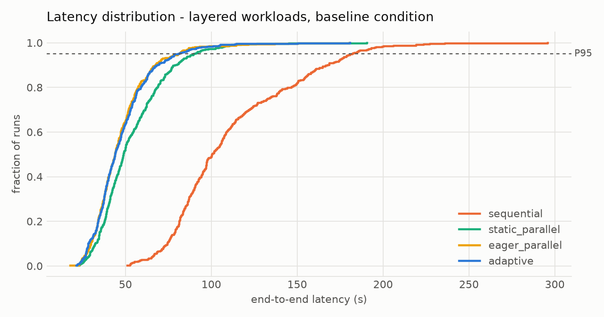

# Benchmark results

Generated by `apsched bench`. Simulation with the calibrated provider model; latencies are
model seconds (selector overhead included for adaptive strategies). 100 evaluation seeds per (workload, condition, strategy); selector uses 64 Monte Carlo samples per candidate on separate seeds. Blind-agent quality q = 0.8.

## Pooled over all workload families

| condition | strategy | success | mean (s) | p95 (s) | cost ($) | calls | speedup vs seq [95% CI] |
|---|---|---|---|---|---|---|---|
| baseline | sequential | 0.999 | 73.6 | 165.7 | 0.0392 | 11.6 | 1.00x [1.00, 1.00] |
| baseline | static_parallel | 1.000 | 42.6 | 90.2 | 0.0392 | 11.6 | 1.73x [1.70, 1.75] |
| baseline | eager_parallel | 1.000 | 40.2 | 86.0 | 0.0392 | 11.6 | 1.83x [1.80, 1.86] |
| baseline | blind_parallel | 0.378 | 36.7 | 74.9 | 0.0443 | 12.6 | 2.00x [1.97, 2.04] |
| baseline | fixed_k_cap | 0.999 | 39.4 | 84.4 | 0.0392 | 11.6 | 1.87x [1.83, 1.90] |
| baseline | adaptive_fifo | 0.999 | 40.3 | 86.1 | 0.0389 | 11.3 | 1.83x [1.80, 1.86] |
| baseline | adaptive_nofusion | 1.000 | 39.8 | 85.4 | 0.0392 | 11.6 | 1.85x [1.82, 1.88] |
| baseline | **adaptive** | 1.000 | 39.9 | 86.0 | 0.0388 | 11.2 | 1.84x [1.81, 1.88] |
| heavy_tail | sequential | 0.999 | 96.2 | 232.6 | 0.0391 | 11.6 | 1.00x [1.00, 1.00] |
| heavy_tail | static_parallel | 0.999 | 61.7 | 146.5 | 0.0391 | 11.6 | 1.56x [1.54, 1.58] |
| heavy_tail | eager_parallel | 0.999 | 57.6 | 137.0 | 0.0392 | 11.6 | 1.67x [1.64, 1.70] |
| heavy_tail | blind_parallel | 0.385 | 54.2 | 126.6 | 0.0442 | 12.6 | 1.77x [1.74, 1.81] |
| heavy_tail | fixed_k_cap | 0.999 | 56.4 | 131.1 | 0.0391 | 11.6 | 1.71x [1.68, 1.73] |
| heavy_tail | adaptive_fifo | 0.998 | 58.1 | 140.8 | 0.0389 | 11.3 | 1.66x [1.63, 1.68] |
| heavy_tail | adaptive_nofusion | 0.999 | 56.7 | 131.3 | 0.0391 | 11.6 | 1.70x [1.67, 1.72] |
| heavy_tail | **adaptive** | 0.999 | 56.9 | 136.5 | 0.0387 | 11.2 | 1.69x [1.66, 1.72] |
| misestimated | sequential | 0.999 | 99.0 | 220.0 | 0.0392 | 11.6 | 1.00x [1.00, 1.00] |
| misestimated | static_parallel | 0.999 | 60.3 | 126.3 | 0.0392 | 11.6 | 1.64x [1.62, 1.66] |
| misestimated | eager_parallel | 0.999 | 57.0 | 120.9 | 0.0392 | 11.6 | 1.74x [1.71, 1.76] |
| misestimated | blind_parallel | 0.369 | 54.7 | 111.1 | 0.0443 | 12.6 | 1.81x [1.78, 1.84] |
| misestimated | fixed_k_cap | 0.999 | 55.3 | 117.4 | 0.0392 | 11.6 | 1.79x [1.77, 1.82] |
| misestimated | adaptive_fifo | 0.999 | 57.1 | 120.8 | 0.0389 | 11.3 | 1.73x [1.71, 1.76] |
| misestimated | adaptive_nofusion | 0.999 | 55.5 | 117.4 | 0.0392 | 11.6 | 1.79x [1.76, 1.81] |
| misestimated | **adaptive** | 0.999 | 55.5 | 117.6 | 0.0389 | 11.4 | 1.79x [1.76, 1.81] |
| tight_limit | sequential | 0.999 | 73.4 | 163.6 | 0.0392 | 11.6 | 1.00x [1.00, 1.00] |
| tight_limit | static_parallel | 0.999 | 56.6 | 121.7 | 0.0392 | 11.6 | 1.30x [1.29, 1.30] |
| tight_limit | eager_parallel | 0.999 | 55.6 | 118.8 | 0.0392 | 11.6 | 1.32x [1.31, 1.33] |
| tight_limit | blind_parallel | 0.382 | 64.5 | 133.1 | 0.0443 | 12.6 | 1.14x [1.13, 1.15] |
| tight_limit | fixed_k_cap | 0.999 | 47.9 | 101.9 | 0.0392 | 11.6 | 1.53x [1.52, 1.55] |
| tight_limit | adaptive_fifo | 0.999 | 49.8 | 105.8 | 0.0386 | 11.0 | 1.47x [1.46, 1.49] |
| tight_limit | adaptive_nofusion | 0.999 | 48.0 | 102.1 | 0.0392 | 11.6 | 1.53x [1.51, 1.54] |
| tight_limit | **adaptive** | 0.999 | 48.0 | 102.4 | 0.0386 | 11.1 | 1.53x [1.51, 1.54] |
| unreliable | sequential | 0.975 | 81.4 | 188.4 | 0.0430 | 12.7 | 1.00x [1.00, 1.00] |
| unreliable | static_parallel | 0.971 | 48.1 | 103.3 | 0.0430 | 12.7 | 1.69x [1.67, 1.72] |
| unreliable | eager_parallel | 0.970 | 45.1 | 99.3 | 0.0429 | 12.6 | 1.80x [1.77, 1.84] |
| unreliable | blind_parallel | 0.371 | 41.2 | 83.5 | 0.0491 | 14.0 | 1.97x [1.94, 2.01] |
| unreliable | fixed_k_cap | 0.972 | 44.4 | 97.1 | 0.0429 | 12.7 | 1.83x [1.80, 1.87] |
| unreliable | adaptive_fifo | 0.971 | 46.0 | 100.1 | 0.0429 | 12.7 | 1.77x [1.74, 1.80] |
| unreliable | adaptive_nofusion | 0.972 | 44.9 | 97.8 | 0.0430 | 12.7 | 1.81x [1.78, 1.85] |
| unreliable | **adaptive** | 0.972 | 45.0 | 97.8 | 0.0430 | 12.6 | 1.81x [1.78, 1.84] |

## H1 - adaptive vs the best fixed strategy (per family x condition)

Objective J = mean + 0.5·P95 + 100.0·cost; fixed strategies must match adaptive's success rate within 2%.

- adaptive is within 5% of the best fixed strategy in **100%** of cells, and better or equal in **66%**
- median relative J: -1.8%; worst cell: +3.8%

| family | condition | best fixed | adaptive J | best fixed J | relative |
|---|---|---|---|---|---|
| chain | baseline | sequential | 119.6 | 119.1 | +0.5% |
| chain | heavy_tail | sequential | 165.3 | 164.7 | +0.3% |
| chain | misestimated | sequential | 158.0 | 158.0 | +0.0% |
| chain | tight_limit | sequential | 119.4 | 121.0 | -1.3% |
| chain | unreliable | sequential | 136.2 | 136.1 | +0.1% |
| fan_out | baseline | static_parallel | 46.3 | 50.5 | -8.3% |
| fan_out | heavy_tail | static_parallel | 74.3 | 77.2 | -3.8% |
| fan_out | misestimated | static_parallel | 67.1 | 78.7 | -14.7% |
| fan_out | tight_limit | static_parallel | 70.3 | 88.1 | -20.2% |
| fan_out | unreliable | static_parallel | 50.1 | 55.3 | -9.4% |
| fork_join | baseline | static_parallel | 123.3 | 122.6 | +0.6% |
| fork_join | heavy_tail | static_parallel | 179.8 | 183.2 | -1.8% |
| fork_join | misestimated | static_parallel | 158.9 | 166.7 | -4.6% |
| fork_join | tight_limit | static_parallel | 134.9 | 151.2 | -10.8% |
| fork_join | unreliable | static_parallel | 134.1 | 134.8 | -0.5% |
| layered | baseline | eager_parallel | 94.2 | 94.0 | +0.2% |
| layered | heavy_tail | eager_parallel | 161.4 | 158.6 | +1.7% |
| layered | misestimated | eager_parallel | 131.5 | 134.7 | -2.4% |
| layered | tight_limit | eager_parallel | 118.4 | 144.7 | -18.2% |
| layered | unreliable | eager_parallel | 109.5 | 107.4 | +2.0% |
| random | baseline | eager_parallel | 85.5 | 87.0 | -1.7% |
| random | heavy_tail | eager_parallel | 137.6 | 142.7 | -3.6% |
| random | misestimated | eager_parallel | 126.0 | 121.4 | +3.8% |
| random | tight_limit | eager_parallel | 99.3 | 122.7 | -19.1% |
| random | unreliable | eager_parallel | 97.9 | 96.6 | +1.3% |
| realistic | baseline | static_parallel | 43.7 | 44.5 | -1.6% |
| realistic | heavy_tail | static_parallel | 67.5 | 69.1 | -2.4% |
| realistic | misestimated | static_parallel | 57.4 | 59.4 | -3.3% |
| realistic | tight_limit | static_parallel | 46.1 | 48.8 | -5.7% |
| realistic | unreliable | static_parallel | 49.9 | 49.5 | +0.8% |
| tree | baseline | eager_parallel | 89.5 | 91.5 | -2.2% |
| tree | heavy_tail | eager_parallel | 140.7 | 139.6 | +0.7% |
| tree | misestimated | eager_parallel | 131.2 | 133.2 | -1.5% |
| tree | tight_limit | eager_parallel | 132.7 | 160.5 | -17.3% |
| tree | unreliable | eager_parallel | 101.7 | 108.1 | -5.9% |

### Paired Wilcoxon tests on latency (adaptive vs X, Holm-corrected)

| condition | vs | pairs | adaptive mean (s) | other mean (s) | p (Holm) |
|---|---|---|---|---|---|
| baseline | sequential | 3400 | 39.9 | 73.6 | <0.001 |
| baseline | static_parallel | 3400 | 39.9 | 42.6 | <0.001 |
| baseline | eager_parallel | 3400 | 39.9 | 40.2 | 0.999 |
| baseline | fixed_k_cap | 3400 | 39.9 | 39.4 | <0.001 |
| baseline | adaptive_fifo | 3400 | 39.9 | 40.3 | 0.201 |
| baseline | adaptive_nofusion | 3400 | 39.9 | 39.8 | <0.001 |
| tight_limit | sequential | 3400 | 48.0 | 73.4 | <0.001 |
| tight_limit | static_parallel | 3400 | 48.0 | 56.6 | <0.001 |
| tight_limit | eager_parallel | 3400 | 48.0 | 55.6 | <0.001 |
| tight_limit | fixed_k_cap | 3400 | 48.0 | 47.9 | <0.001 |
| tight_limit | adaptive_fifo | 3400 | 48.0 | 49.8 | <0.001 |
| tight_limit | adaptive_nofusion | 3400 | 48.0 | 48.0 | <0.001 |
| heavy_tail | sequential | 3400 | 56.9 | 96.2 | <0.001 |
| heavy_tail | static_parallel | 3400 | 56.9 | 61.7 | <0.001 |
| heavy_tail | eager_parallel | 3400 | 56.9 | 57.6 | 0.999 |
| heavy_tail | fixed_k_cap | 3400 | 56.9 | 56.4 | <0.001 |
| heavy_tail | adaptive_fifo | 3400 | 56.9 | 58.1 | 0.024 |
| heavy_tail | adaptive_nofusion | 3400 | 56.9 | 56.7 | <0.001 |
| unreliable | sequential | 3400 | 45.0 | 81.4 | <0.001 |
| unreliable | static_parallel | 3400 | 45.0 | 48.1 | <0.001 |
| unreliable | eager_parallel | 3400 | 45.0 | 45.1 | <0.001 |
| unreliable | fixed_k_cap | 3400 | 45.0 | 44.4 | <0.001 |
| unreliable | adaptive_fifo | 3400 | 45.0 | 46.0 | 0.005 |
| unreliable | adaptive_nofusion | 3400 | 45.0 | 44.9 | <0.001 |
| misestimated | sequential | 3400 | 55.5 | 99.0 | <0.001 |
| misestimated | static_parallel | 3400 | 55.5 | 60.3 | <0.001 |
| misestimated | eager_parallel | 3400 | 55.5 | 57.0 | <0.001 |
| misestimated | fixed_k_cap | 3400 | 55.5 | 55.3 | <0.001 |
| misestimated | adaptive_fifo | 3400 | 55.5 | 57.1 | <0.001 |
| misestimated | adaptive_nofusion | 3400 | 55.5 | 55.5 | <0.001 |

## H2 - dependency-blind multi-agent fan-out (baseline condition)

| family | sequential success | blind success (q = 0.8) |
|---|---|---|
| chain | 1.000 | 0.172 |
| fan_out | 1.000 | 0.777 |
| fork_join | 1.000 | 0.075 |
| layered | 1.000 | 0.117 |
| random | 0.998 | 0.128 |
| realistic | 1.000 | 0.690 |
| tree | 0.998 | 0.220 |

Sensitivity of blind success to the per-task quality q (expected success):

| family | q=0.6 | q=0.7 | q=0.8 | q=0.9 | q=0.95 | q=1 |
|---|---|---|---|---|---|---|
| chain | 0.030 | 0.078 | 0.189 | 0.443 | 0.668 | 1.000 |
| fan_out | 0.600 | 0.700 | 0.800 | 0.900 | 0.950 | 1.000 |
| fork_join | 0.004 | 0.016 | 0.056 | 0.216 | 0.455 | 0.998 |
| layered | 0.013 | 0.038 | 0.109 | 0.319 | 0.560 | 1.000 |
| random | 0.010 | 0.038 | 0.124 | 0.365 | 0.608 | 0.998 |
| realistic | 0.476 | 0.569 | 0.685 | 0.827 | 0.909 | 1.000 |
| tree | 0.068 | 0.128 | 0.242 | 0.473 | 0.679 | 1.000 |

## H3 - critical-path priority vs FIFO (ablation)

| metric | adaptive | FIFO |
|---|---|---|
| mean latency (s) | 49.07 | 50.26 |
| p95 latency (s) | 109.35 | 111.45 |
| model calls | 11.51 | 11.54 |
| cost ($) | 0.0396 | 0.0396 |
| success | 0.994 | 0.993 |

Paired Wilcoxon on latency: p = <0.001 over 17000 pairs.

## H4 - task fusion (ablation: no fusion)

| metric | adaptive | no fusion |
|---|---|---|
| mean latency (s) | 49.07 | 48.96 |
| p95 latency (s) | 109.35 | 108.67 |
| model calls | 11.51 | 11.80 |
| cost ($) | 0.0396 | 0.0399 |
| success | 0.994 | 0.994 |

Paired Wilcoxon on latency: p = <0.001 over 17000 pairs.

## Ablation - no cost model (k = provider cap)

| metric | adaptive | k = cap |
|---|---|---|
| mean latency (s) | 49.07 | 48.68 |
| p95 latency (s) | 109.35 | 108.33 |
| model calls | 11.51 | 11.80 |
| cost ($) | 0.0396 | 0.0399 |
| success | 0.994 | 0.994 |

Paired Wilcoxon on latency: p = <0.001 over 17000 pairs.

## Selector accuracy (hindsight)

Over 170 (workload, condition) units the selector picked the configuration that was best on the oracle sample (200 runs per candidate) in **70%** of units; its choice was within 1% of the best in 80% and within 5% in 91% (mean regret 1.01%, max 17.6%). Mean selection time 240 ms.

Mean prediction error of the chosen configuration's latency (predicted / realized - 1):

| condition | error |
|---|---|
| baseline | -0.9% |
| tight_limit | -1.1% |
| heavy_tail | -0.2% |
| unreliable | -0.6% |
| misestimated | -30.2% |

## Figures

